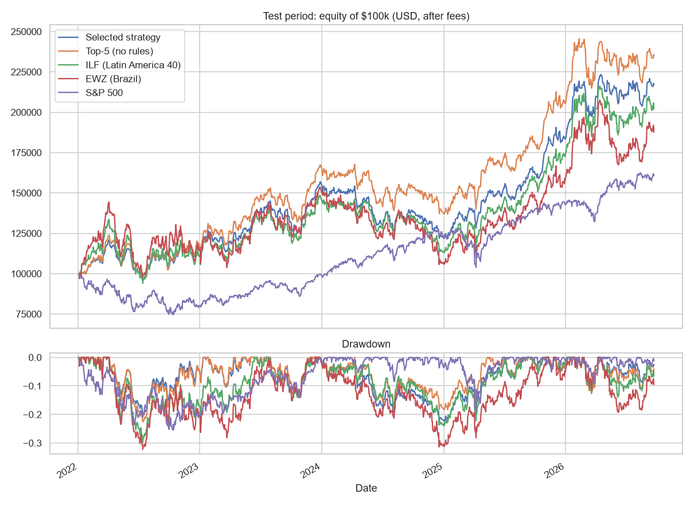
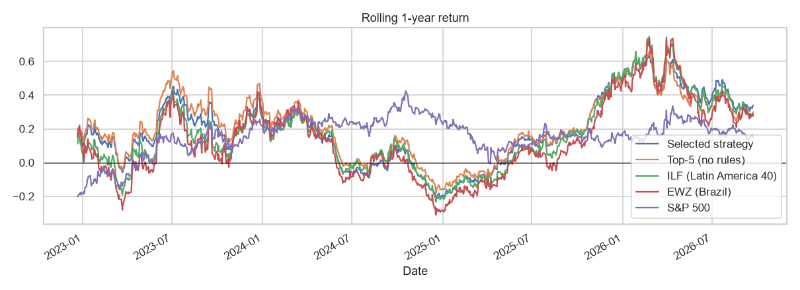

# LatAm Stock Signals: an end-to-end algo-trading system for Latin American equities

Final project of the [Stock Markets Analytics Zoomcamp 2026](https://github.com/DataTalksClub/stock-markets-analytics-zoomcamp) (DataTalksClub + PythonInvest).

**Every day after the market close, the system picks the Latin American stocks most likely to beat their country ETF over the next month, simulates the strategy and publishes the trades for the next session.**

**Results on the out-of-sample test period (Jan-2022 → Sep-2026, USD, after 0.1% fees per side):**

| Portfolio ($100k) | CAGR | Volatility | Sharpe | Max drawdown |
|---|---|---|---|---|
| **Strategy: XGBoost top-5 per day, 10% stop-loss, size by probability** | **17.9%** | **14.9%** | **0.89** | **-22.4%** |
| ILF - iShares Latin America 40 ETF | 16.1% | 22.6% | 0.58 | -29.7% |
| EWZ - iShares MSCI Brazil ETF | 14.3% | 26.6% | 0.47 | -32.2% |
| S&P 500 | 10.6% | 16.9% | 0.43 | -25.4% |




## Contents

1. [Problem](#1-problem)
2. [Data sources](#2-data-sources)
3. [Transformations and features](#3-transformations-and-features)
4. [Modeling](#4-modeling)
5. [Trading simulation](#5-trading-simulation)
6. [Automation](#6-automation)
7. [How to run it](#7-how-to-run-it)
8. [Findings, limitations and next steps](#8-findings-limitations-and-next-steps)

---

## 1. Problem

Latin American stock markets are cheap, volatile and covered by few analysts, which makes them a good place to look for mispricing. A foreign (or Argentine) investor usually gets exposure through a **country ETF** such as EWZ (Brazil) or EWW (Mexico). The question of this project is:

> Can a model pick, every day, the stocks that will **outperform their country ETF in USD over the next 20 trading days** (~1 month), and can a simple strategy built on those picks beat buying the ETFs?

- **Universe:** 239 large and liquid stocks from 5 markets: Brazil (148 stocks of the IBrA index, B3), Mexico (36, S&P/BMV IPC), Chile (30, S&P IPSA), Argentina (18 NYSE/Nasdaq ADRs) and Andean ADRs (7, Colombia and Peru).
- **Target (`is_outperform_20d`):** 1 if the stock's 20-day return in USD is higher than the 20-day return of its country ETF (EWZ, EWW, ECH, ARGT; ILF for the Andean ADRs).
- **Why relative and in USD:** prices are converted to USD with the daily FX rate so that all markets are comparable and the result is what a dollar-based investor actually gets. Beating the ETF removes the market direction (and the FX move) from the target: the model only has to rank stocks inside each market.
- **How the solution is used:** after the close, `python main.py` (cron) updates the data, predicts every stock, and writes the top-k candidates to `output/latest_signals.csv` and `output/daily_report.md` (optionally sent to Telegram). Positions are held 20 trading days.

What is new compared with the course: different stock exchanges (Brazil, Mexico, Chile, Argentina, Colombia, Peru), a relative target vs a tradable benchmark, prices converted to USD, central bank data, and a long-short variant of the strategy.

## 2. Data sources

| Source | What | How |
|---|---|---|
| **Yahoo Finance** (`yfinance`) | Daily OHLCV of the 239 stocks (2004 → today); country / regional ETFs (EWZ, EWW, ECH, ARGT, ILF); S&P 500; local indexes (Ibovespa, IPC, Merval); FX (USD/BRL, USD/MXN, USD/CLP, dollar index); commodities (Brent, copper, gold, soybeans, iron ore); US rates (^IRX, ^FVX, ^TNX) and VIX | batch download + incremental updates |
| **B3 website API** (new source, scraping) | Constituents of the IBrA index and the **economic sector** of each Brazilian stock | the B3 page calls an internal endpoint whose parameter is a base64-encoded JSON; replicated in `get_b3_universe()` |
| **Banco Central do Brasil, SGS API** (new source) | Selic target rate (daily) and inflation IPCA (monthly, 12-month) | REST API, requested in windows of ≤10 years |
| **BCRA API v4.0** (new source) | Argentine central bank international reserves | REST API, paginated by year |

FRED (used in the course) blocks automated downloads from this machine, so the US rates come from Yahoo Finance (`^IRX`, `^FVX`, `^TNX`).

**Size:** 1,011,291 daily stock records (2004-2026), plus 22 market series and 4 macro series. After cleaning and from 2005 onwards: 937,505 rows × 216 columns.

Data files are **not** stored on GitHub: they are downloaded from the APIs (`python main.py`) or from a snapshot on Google Drive (`python main.py --fast`).

## 3. Transformations and features

`scripts/transform.py` builds one table with a row per (stock, day). Feature sets (`FEATURE_SETS` in the script):

| Set | # | Description |
|---|---|---|
| GROWTH | 8 | Past USD returns: 1, 3, 5, 10, 20, 60, 120, 250 days (course features) |
| TECHNICAL | 14 | Close / SMA 10-20-50-200, SMA10 > SMA20, high-low range, volatility 20/60d, log volume, **log traded value in USD**, **volume ratio 5/60d**, **Amihud illiquidity**, **distance to 52-week high and low** |
| TALIB | 29 | Scale-free TA-Lib momentum and cycle indicators (ADX, AROON, CCI, CMO, MFI, PPO, RSI, STOCH, STOCHRSI, TRIX, ULTOSC, WILLR, NATR, MACD histogram / price, Hilbert transform...) |
| PATTERNS | 61 | All TA-Lib candlestick patterns (-1 / 0 / 1) |
| RELATIVE (new) | 10 | **Relative strength vs the country ETF** (5, 20, 60, 120, 250 days) and **vs the S&P 500** (20, 60), **rolling beta** and **idiosyncratic volatility** (120 days), ETF growth 20d |
| CROSS (new) | 10 | **Cross-sectional percentile ranks inside each market and day** (momentum 20/60/250d, volatility, RSI, liquidity, distance to the 52w high), **market breadth** (% of stocks above SMA200), median market return, number of stocks |
| MARKET (new) | 55 | Growth 5/20/60d of ETFs, FX, commodities and dollar index; FX volatility; VIX level and change; US 10y, 3m, yield curve; S&P 500 above SMA200 |
| MACRO (new) | 6 | Selic, IPCA 12m, **real Selic rate**, **Selic - US 3m spread**, BCRA reserves growth 20d / 250d |
| CATEGORICAL → dummies | 10 | Market, Sector, month, weekday + binned variables: **RSI zone**, **volatility quintile**, **momentum quintile**, **near 52w high**, **VIX regime**, **market regime (bull/bear)** |

Targets (`TO_PREDICT`): `growth_future_20d`, `excess_future_20d`, `is_outperform_20d`, `is_positive_growth_20d`.

Indicators that depend on the price scale (OBV, AD, ATR, raw MACD) are left out: with 239 stocks at very different prices they are not comparable across stocks.

**Data cleaning** (important findings):
- Yahoo has days with zero volume and broken split adjustments in the early years of illiquid Brazilian stocks (e.g. a stock going from 8,640 to 0.62 in a week). Rows with no volume are removed and each stock starts after its last impossible one-day jump (> ×2.7): 56k rows removed.
- The USD/CLP series has isolated prints ~100 times off, which made all Chilean stocks "jump" ×100 in USD. Market series are filtered against their 5-day median.
- Macro data is lagged to its publication date (IPCA +45 days, Selic and reserves +1 day) to avoid look-ahead bias.
- **Liquidity filter:** models and strategies only use stocks with ≥ US$1M traded per day (20-day average): 685k rows.

EDA: [`notebooks/01_eda.ipynb`](notebooks/01_eda.ipynb).

## 4. Modeling

`scripts/train.py` - notebook: [`notebooks/02_modeling.ipynb`](notebooks/02_modeling.ipynb)

- **Split in time with a 20-day embargo** (the target looks 20 days ahead, so the last days of each set would leak into the next): train 2005-2018 (331k rows), validation 2019-2021 (116k), test 2022-2026 (231k). The test period is never used for any decision.
- **Step 1, feature-set selection** (XGBoost, validation AUC): all 251 features 0.515 · without market/macro 0.526 · **stock-level only (107) 0.532**. Market and macro features are the same for every stock of a day, so the trees use them to memorise periods; they are used as trading filters instead.
- **Step 2, hyperparameter tuning** on validation: DecisionTree (depth × min leaf), RandomForest (depth × max features) and **XGBoost** (depth × column sampling, early stopping). The best configuration of each family is refitted on train + validation.
- Validation predictions come from the models fitted on train only, so the trading strategy can be chosen on validation with out-of-sample predictions.

| Model (test 2022-2026) | ROC AUC | Precision top-10 per day | Avg excess return of the top-10 (20d) |
|---|---|---|---|
| DecisionTree (depth 8) | 0.511 | 48.5% | +0.12% |
| RandomForest (depth 14, 150 trees) | **0.531** | **54.2%** | **+1.00%** |
| XGBoost (depth 3, 234 trees) | 0.524 | 51.3% | +0.42% |
| Ensemble (mean) | 0.521 | 51.9% | +0.58% |
| *All stocks (base rate)* | | *48.1%* | *+0.08%* |

**Custom decision rules:** probabilities are concentrated around 0.5, so fixed thresholds give an unstable number of trades (from ~90 signals per day at p > 0.5 to < 1 at p > 0.6). The strategies use **top-k per day** rules (and p > 0.55 for `sim1`).

Most important features: short and medium-term momentum (`growth_10d`, `growth_20d`, `growth_250d`), distance to the 52-week high, RSI / CMO, volatility, relative strength vs the ETF (5 and 250 days), sector and market dummies.

## 5. Trading simulation

`scripts/simulate.py` - notebook: [`notebooks/03_simulation.ipynb`](notebooks/03_simulation.ipynb)

**Vectorised simulations** ($100 per trade, 20-day holding, fees included; fields `sim1_*` ... `sim4_*` are generated for every prediction). Approximate CAGR on the capital needed (as in the course), test period:

| Strategy | DecisionTree | RandomForest | XGBoost | Ensemble |
|---|---|---|---|---|
| sim1: p > 0.55 | 1.113 | 1.147 | 1.119 | 1.117 |
| sim2: top-5 per day | 1.134 | **1.207** | 1.165 | 1.183 |
| sim3: top-5, bull market only | 1.034 | 1.123 | 1.081 | 1.097 |
| sim4: long top-5 / short bottom-5 (market neutral) | 0.971 | 1.090 | 1.048 | 1.071 |

**Exact simulation** (`exact_simulation`): $100k, every day 1/20 of the equity is invested in the top-k signals (so the capital is fully used after 20 days), gains are reinvested, one position per ticker, positions are marked to market every day. Options: stop-loss / take-profit on the daily close, position size proportional to the probability, market-regime filter.

**Strategy selection on validation (2019-2021)**, 72 combinations (3 models × k ∈ {5, 10} × stop-loss/take-profit × sizing × regime filter), ranked by Sharpe ratio. Selected: **XGBoost, top-5, 10% stop-loss, size by probability**. The 10% stop-loss is in all the top configurations; the regime filter never is (it skips the rebounds after crashes).

**Test (2022-2026):** see the table at the top. The strategy beats ILF, EWZ and the S&P 500 in CAGR with lower volatility and drawdown, and its 1-year rolling return is above ILF ~70% of the days. All 10 best validation configurations also beat ILF on test (CAGR 15-20%), so the result does not hinge on one lucky choice. The plain top-5 without rules made 19.8% with more volatility: the stop-loss gives up some return for a smoother curve.



**Deep analysis** (notebooks 02 and 03):
- Precision of the top-5 picks by market: Argentina 64%, Andean ADRs 59%, Mexico 58%, Chile 52%, Brazil 49% (base rates 47-54%). Brazil is half of the trades but the weakest market.
- By sector: Real Estate, Communication, Financials and Energy work best; Health Care and Technology picks lose.
- By year: 2024 was the only losing year (win rate 41%); 2023 and 2025 were the best.
- Stop-losses fire in ~17% of the trades; time exits average +4.2%: the edge comes from holding winners for the full period.
- Several of the worst picks are Brazilian materials stocks (CBAV3, CMIN3) that kept falling for weeks after the signal.

Ideas: one model per market (or more weight on non-Brazilian picks), a cap on positions per sector, a currency-regime filter, and a ranking target (top quintile of excess return) instead of a binary one.


## 6. Automation

```
config.py              universe, market symbols, paths, selected strategy
main.py                daily workflow (download -> transform -> predict -> simulate -> report)
scripts/
  data_repo.py         Step 1: DataRepository - B3 / Yahoo / BCB / BCRA downloads, incremental update, parquet storage
  transform.py         Step 2: TransformData - cleaning, ~190 features, targets, feature sets
  train.py             Step 3: TrainModel - split with embargo, feature-set selection, tuning, final models, predictions
  simulate.py          Step 4: vectorised simulations, exact simulation, CAGR / Sharpe / drawdown, benchmarks
  report.py            Step 5: latest signals, model health monitoring, Markdown report, Telegram message
  snapshot.py          zip data/ for Google Drive and download it for the fast regime
notebooks/
  00_workflow.ipynb    calls every step from the scripts (end-to-end run + latest trades)
  01_eda.ipynb         exploratory data analysis
  02_modeling.ipynb    tuning results, scores, decision rules, feature importance, error analysis
  03_simulation.ipynb  vectorised and exact simulations, strategy selection, benchmarks
Dockerfile             container that runs main.py with data/ and output/ as volumes
```

**Two regimes**

| Command | What it does | Time |
|---|---|---|
| `python main.py` | Incremental download (last 10 days; full history only for new tickers or tickers whose adjusted prices changed) + transformations + predictions with the saved models + simulation + report | ~7-8 min (mostly API downloads) |
| `python main.py --fast` | No download and no transformations: reads `data/` (downloaded from the Google Drive snapshot if it is empty). Easy to replicate, but no new data | ~1 min |
| `python main.py --retrain` | Also selects features, tunes and refits the models (weekly or monthly) | +20-30 min |
| `python main.py --full-reload` | Downloads the full history again | ~8 min more |

**Incremental storage:** raw data is kept in `data/raw/*.parquet` (outside GitHub). Each run downloads only the last 10 days and compares the overlapping closes with the stored ones; if Yahoo changed the past (a new dividend or split adjusts the whole history), that ticker is downloaded again in full.

**Cron** (Linux/macOS, Monday to Friday at 21:30 UTC, after the close of B3, BMV, Santiago and NYSE):

```cron
30 21 * * 1-5 cd /path/to/project && /path/to/uv run python main.py >> output/cron.log 2>&1
0 12 * * 6    cd /path/to/project && /path/to/uv run python main.py --retrain >> output/cron.log 2>&1
```

Windows (Task Scheduler):

```powershell
schtasks /Create /TN "latam-signals" /SC WEEKLY /D MON,TUE,WED,THU,FRI /ST 18:30 `
  /TR "cmd /c cd /d D:\path\to\project && uv run python main.py >> output\cron.log 2>&1"
```

**Monitoring:** `output/daily_report.md` includes the precision of the top-5 picks over the last 120 days with a known outcome vs the base rate, and the average excess return of the picks. With `TELEGRAM_BOT_TOKEN` and `TELEGRAM_CHAT_ID` set, the signals are also sent to a Telegram chat.

Example (run of 2026-10-21): the top-5 precision of the last 120 days was 42.8% vs a 45.8% base rate (average excess -0.9%). A value below the base rate for several weeks is the signal to review the model or run `--retrain`.

## 7. How to run it

Requirements: [uv](https://docs.astral.sh/uv/) (it installs Python 3.12 and the exact versions in `uv.lock`). TA-Lib ≥ 0.6 ships wheels with the C library included, so no extra installation is needed on Windows, Linux or macOS.

```bash
git clone https://github.com/exequiel-santucho/latam-stock-signals.git
cd latam-stock-signals
uv sync                                  # creates .venv with all dependencies
uv run python main.py                    # first run: full download (~8 min) + transform + train (~25 min)
uv run python main.py                    # next days: incremental update + predictions (~7 min)
uv run jupyter lab notebooks/            # research notebooks
```

To activate the environment instead of using `uv run`: `source .venv/bin/activate` (Linux/macOS) or `.venv\Scripts\activate` (Windows).

Fast regime from the Google Drive snapshot (~370 MB: raw data, dataset and models): with `SNAPSHOT_URL` set in `config.py`, `uv run python main.py --fast` downloads and unzips it into `data/` on the first run. To publish a new snapshot: `uv run python -m scripts.snapshot` and upload `snapshot.zip` to Google Drive ("anyone with the link").

Docker:

```bash
docker build -t latam-signals .
docker run --rm -v "$PWD/data:/app/data" -v "$PWD/output:/app/output" latam-signals          # daily run
docker run --rm -v "$PWD/data:/app/data" -v "$PWD/output:/app/output" latam-signals --fast   # fast regime
```

Run the steps one by one:

```bash
uv run python -m scripts.data_repo    # download / update data/raw
uv run python -m scripts.transform    # build data/processed/dataset.parquet
uv run python -m scripts.train        # feature selection + tuning + final models + predictions
```

## 8. Findings, limitations and next steps

- **Signal strength:** future 20-day returns are very noisy; the useful signal is in the ranking (top of the list), not in the AUC.
- **Survivorship bias:** the universe uses today's index members. Stocks that were delisted or left the indexes are missing, which flatters the past results of the whole universe (and partly of the strategy). A point-in-time list of constituents would fix it.
- **Execution:** trades are simulated at the close of the signal day; in practice they would be executed at the next open. Fees are 0.1% per side; spreads of small caps and taxes are not included. Short selling (sim4) is not available for most Latin American stocks to retail investors.
- **Data quality:** Yahoo Finance data for Latin America needs cleaning (zero-volume days, broken split adjustments, FX glitches); FRED could not be used from this machine.
- **Next steps:** point-in-time universe, execution at the next open, per-market models, a broker integration for the ADRs (e.g. Alpaca or Interactive Brokers API) and cloud scheduling (GitHub Actions or a small VM with cron).

## Disclaimer

Educational project. Not financial advice.
